<div align="center">

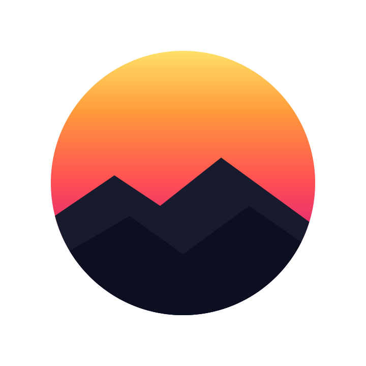

# SunSet Viewer

**Um visualizador moderno para o Second Life, desenvolvido em Rust.**<br>
Renderizador Vulkan, interface limpa e o Second Life que você já conhece.

[ **English** ](README.md) · [ **Português (Brasil)** ](README.pt-BR.md)

[](https://github.com/SunSet-Viewer/SunSet-Viewer/releases/latest)&nbsp;
[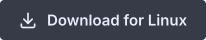](docs/LINUX.md)&nbsp;
[](docs/MACOS.md)&nbsp;

[](https://github.com/SunSet-Viewer/SunSet-Viewer/releases)
[](LICENSE)
[](https://www.rust-lang.org)
[](#compilação)

<sub>O SunSet Viewer é uma versão modificada e mantida de forma independente com base no <a href="https://github.com/Aurora-Viewer/Aurora-Viewer">Aurora Viewer</a>. Não é uma versão oficial do Aurora nem da Linden Lab, e nenhum dos dois projetos o endossa ou apoia diretamente.</sub>

[Por que o SunSet](#por-que-o-sunset) · [Destaques Exclusivos](#destaques-exclusivos-do-sunset-) · [Criadores](#ferramentas-para-criadores) · [Desempenho](#desempenho) · [Recursos](#o-que-funciona-hoje) · [Como Usar](#como-usar-o-sunset) · [Compilação](#compilação) · [Contribuindo](#contribuindo)

</div>

**Altas taxas de quadros e baixo frame time, teletransportes e carregamentos ultrarrápidos, graças a tecnologias modernas como Vulkan e Rust.**  
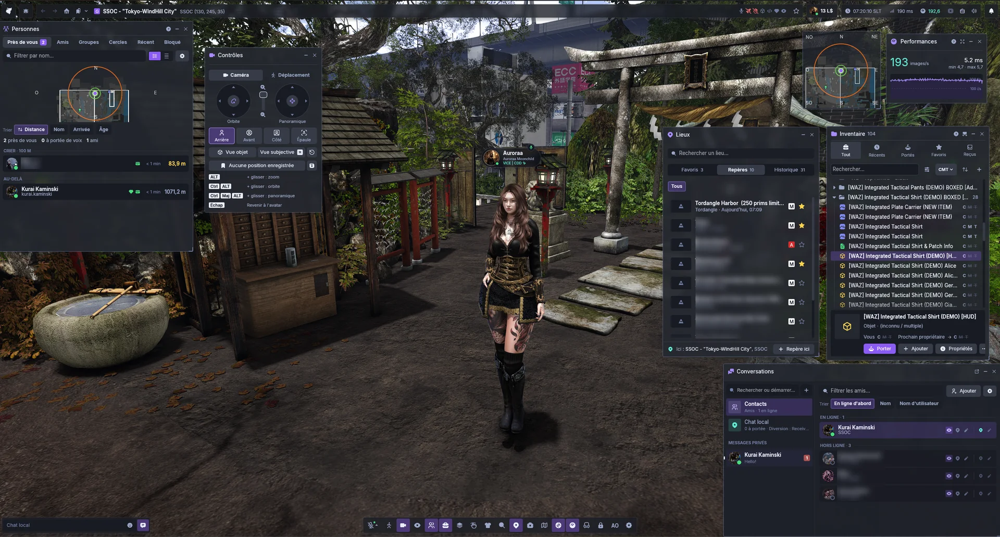  

**Todas as ferramentas que você precisa para aproveitar o Second Life da melhor forma: modo Foto profissional, Auto Hover Height e muita qualidade de vida!**  
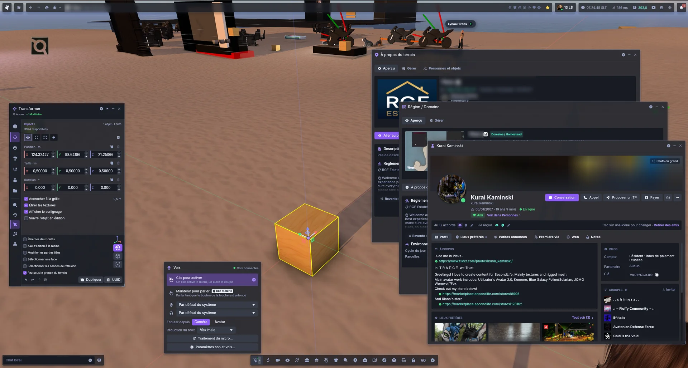  

**Interface moderna e botões de alternância para trazer de volta a interface Clássica nos módulos que você preferir!**  
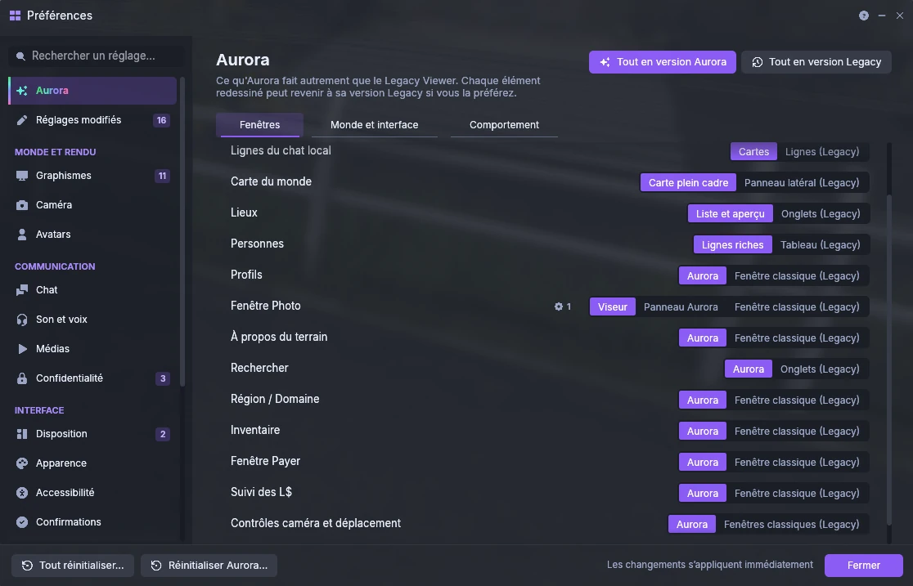

**Nova experiência de login com suporte a múltiplas contas de avatar.**  
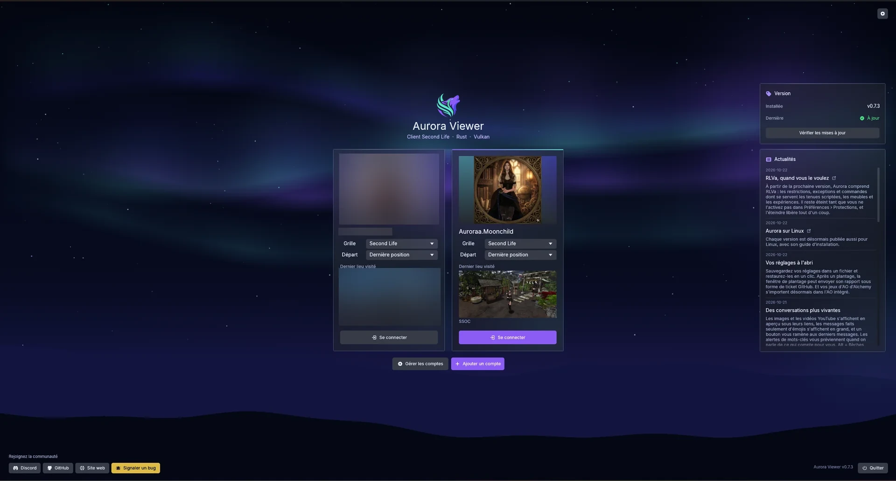  

<details>
<summary><b>Mais capturas de tela</b>: conversas, notificações, inventário, lugares, pesquisa e monitor de recursos</summary>
<br>
<table>
  <tr>
    <td width="50%" valign="top">
      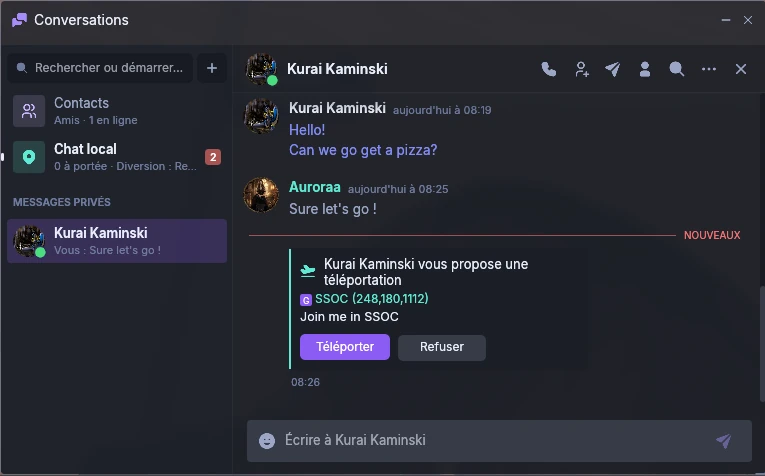<br>
      <b>Conversas</b> estilo mensageiro: balões, fotos e ofertas de teletransporte ou presentes diretamente na conversa.
    </td>
    <td width="50%" valign="top">
      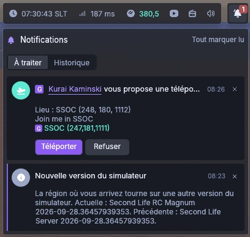<br>
      <b>Central de Notificações</b> acessível pelo sino, mantendo o histórico de tudo o que você perdeu.
    </td>
  </tr>
  <tr>
    <td valign="top">
      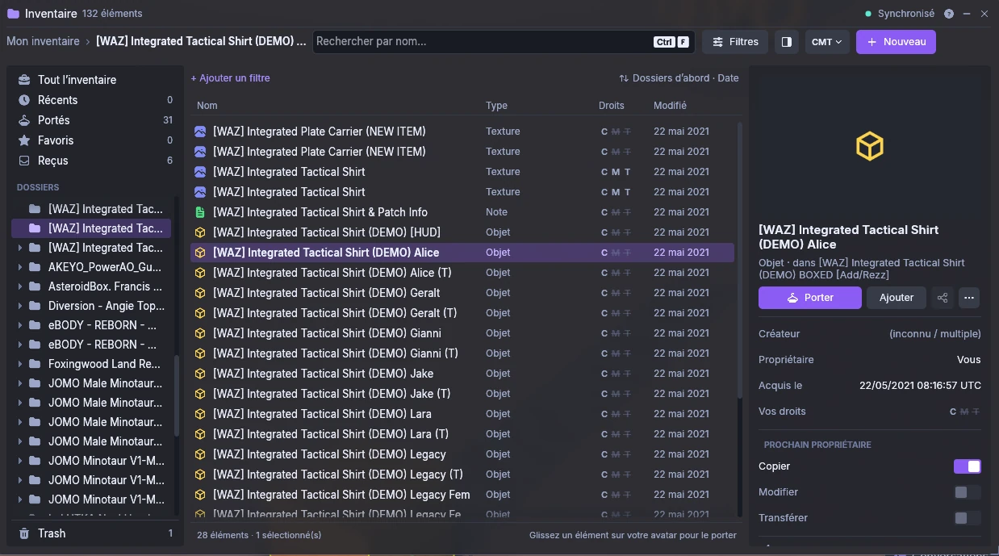<br>
      <b>Inventário</b> que se expande em um explorador completo: pastas, detalhes, filtros e permissões de cada item em um relance.
    </td>
    <td valign="top">
      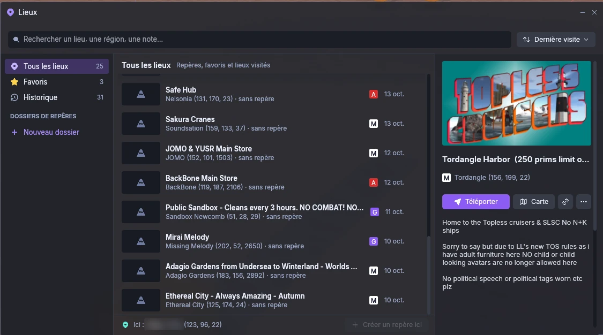<br>
      <b>Lugares</b>: favoritos, marcos (landmarks) e histórico em uma lista só, com pré-visualização de cada local.
    </td>
  </tr>
  <tr>
    <td valign="top">
      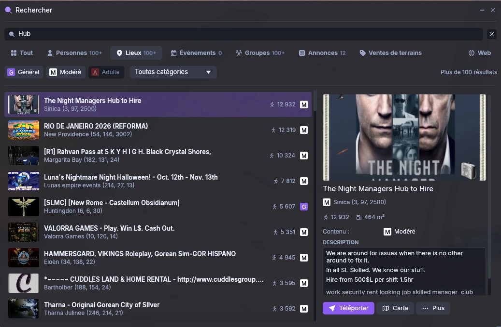<br>
      <b>Pesquisa Universal</b> para residentes, lugares, eventos, grupos e classificados, com os detalhes ao lado dos resultados.
    </td>
    <td valign="top">
      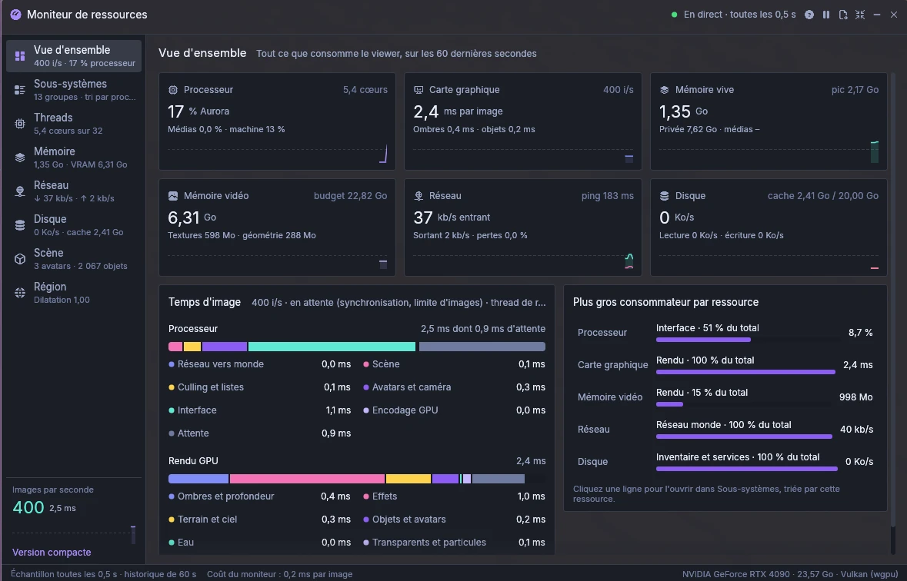<br>
      <b>Monitor de Recursos</b> que mostra para onde vai cada milissegundo, megabyte e kilobit.
    </td>
  </tr>
</table>
</details>

O SunSet Viewer é um cliente modificado para Second Life baseado no [Aurora Viewer](https://github.com/Aurora-Viewer/Aurora-Viewer), equipado com um renderizador moderno de GPU (wgpu sobre Vulkan) e uma interface limpa. Também contém código derivado do visualizador oficial do Second Life e do Firestorm. A autoria original, licenças e a relação upstream estão documentadas em [NOTICE.md](NOTICE.md).

> **Status:** Desenvolvimento ativo (0.x). Perfeitamente utilizável para explorar, conversar, construir e testar.

---

## Por que o SunSet

<table>
  <tr>
    <td width="25%" align="center" valign="top">
      <h3>≈ 5×</h3>
      mais FPS do que um visualizador clássico em lojas movimentadas
    </td>
    <td width="25%" align="center" valign="top">
      <h3>≈ ½</h3>
      da memória de vídeo (VRAM) para as mesmas texturas
    </td>
    <td width="25%" align="center" valign="top">
      <h3>Instantâneo</h3>
      teletransportes dentro da mesma região, sem tela de carregamento
    </td>
    <td width="25%" align="center" valign="top">
      <h3>Vulkan</h3>
      renderizador de última geração projetado para placas de vídeo atuais
    </td>
  </tr>
</table>

### Destaques Exclusivos do SunSet 

<table>
  <tr>
    <td width="50%" valign="top">
      <h3>⚔️ Combate 3D & Cores Individuais</h3>
      Sistema completo de combate em tempo real (<code>scene::combat</code>) com raycasting do centro da tela, hitboxes 3D por avatar/articulação, oclusão por paredes e <b>marcação individual de cores</b> no Hitbox e Minimapa (<a href="docs/HITBOX_E_CORES.md">guia</a>).
    </td>
    <td width="50%" valign="top">
      <h3>🚀 Movimento 100x, Dash & Alcance 8.192m</h3>
      Multiplicador de velocidade até <b>100x</b> (Bridge v1.42), Salto Instantâneo (<b>Dash</b>) com atalhos em Mouselook (<a href="docs/MOVEMENT_DASH.md">guia</a>) e distância de visão desbloqueada até <b>8.192 metros</b> (<code>dd 5000</code>) com SpeedRez (<a href="docs/DRAW_DISTANCE.md">guia</a>).
    </td>
  </tr>
  <tr>
    <td valign="top">
      <h3>🇧🇷 Localização 100% Nativa em Português (pt-BR)</h3>
      Tradução integral e criteriosa de mais de 12.770 termos de interface, menus e mensagens de sistema, adotando o jargão consagrado do Second Life no Brasil (ex: <i>"Em uso"</i>, <i>"Desanexar de você"</i>, <i>"Sempre correr"</i>).
    </td>
    <td valign="top">
      <h3>⚡ Upscaling AMD FSR 3.1 & Auto-Updates</h3>
      AMD FidelityFX Super Resolution 3.1 nativo em WGSL para alto FPS em 1440p/4K e atualizador automático em segundo plano com verificação SHA-256 integrado ao GitHub Releases.
    </td>
  </tr>
</table>

### Novidades da v0.9.7 (Base Aurora 0.9.4 + SunSet) 

<table>
  <tr>
    <td width="50%" valign="top">
      <h3>🔧 Configurações de Depuração (Ctrl+Alt+Shift+S)</h3>
      Todas as configurações por nome técnico em uma única janela: pesquise nomes e descrições, filtre o que foi alterado e restaure qualquer item ao padrão com um clique.
    </td>
    <td width="50%" valign="top">
      <h3>🏗️ Preferências de Construção & SpeedRez 8.192m</h3>
      Nova aba de Construção para novos prims, <b>Distância de Visão Progressiva (SpeedRez)</b> harmonizada até 8.192m (<code>dd 5000+</code>), detalhe de árvores, proteção contra superfícies gigantes e suavização de câmera até 300.
    </td>
  </tr>
  <tr>
    <td valign="top">
      <h3>🌍 Mundo Mais Completo e Resiliente</h3>
      Regiões vizinhas carregam dinamicamente conforme sua distância de visão, objetos não somem mais em certos ângulos de câmera e a cena se recupera sozinha caso a VRAM encha no login.
    </td>
    <td valign="top">
      <h3>🔊 Chamadas, Música e Conversas</h3>
      Chamadas de voz privadas continuam conectadas durante teletransportes, a música do terreno não corta mais ao mover a câmera livremente e <code>Ctrl+Tab</code> alterna entre conversas.
    </td>
  </tr>
</table>

---

### Rápido e Fluido

- **Centenas de quadros por segundo em locais lotados.** Em lojas movimentadas com cerca de 16.000 objetos, o SunSet alcança em torno de 340 a 386 FPS onde visualizadores clássicos rodam a 68 FPS no mesmo computador e no mesmo local ([veja a medição](#desempenho)).
- **A imagem continua em movimento ao chegar.** Texturas e malhas (meshes) são decodificadas em threads secundárias e gravadas diretamente na memória da GPU, evitando congelamentos ao aterrissar em regiões movimentadas.
- **Lugares conhecidos carregam na hora.** As texturas ficam em cache no disco prontas para a placa de vídeo: voltando a um local já visitado, nada precisa ser decodificado novamente.
- **Aproximadamente metade da memória de vídeo para texturas**, sem perda perceptível aos olhos: cada textura comprimida em BC7 é verificada antes de ser mantida.
- **Teletransportes instantâneos dentro da região.** Teletransportes para outros simuladores exibem o último quadro desfocado com progresso real passo a passo.
- **A placa de vídeo finalmente faz o trabalho pesado.** A GPU decide por si mesma o que está visível (culling em compute shaders) e desenha milhares de objetos em pouquíssimas chamadas, enquanto uma thread dedicada de renderização mantém o fluxo constante de quadros.
- **Conexão resiliente**: instabilidades rápidas de rede não derrubam mais a sua sessão (o SunSet reconecta você exatamente de onde parou).
- **Inventário completo carregado em segundo plano**: desde o login, suas pastas já estão prontas quando você as abre.
- **Seleção automática da melhor GPU em notebooks**: em PCs com GPU integrada e placa dedicada, o SunSet escolhe automaticamente a dedicada.
- **AMD FSR 3.1 nativo**: reduza a resolução interna da cena de 67% até 33% e reconstrua a imagem nítida com anti-aliasing avançado para ganhar ainda mais FPS (Preferências › Gráficos › Anti-aliasing).

---

### Imagem Mais Nítida e Rica

- **Oclusão de Ambiente Moderna (GTAO)**: sombreamento suave e realista em cantos, sob móveis e ao redor dos avatares, impedindo reflexos em locais onde a luz não chega.
- **Sombras de Contato do Sol**: pequenas sombras que firmam pés, roupas e objetos no chão, onde os mapas de sombra tradicionais costumam falhar.
- **Anti-aliasing Especular**: superfícies brilhantes não cintilam mais conforme a câmera se desloca.
- **Movimento sem Borrões**: o TAA acompanha o vetor de movimento de cada pixel, garantindo nitidez total em avatares e objetos que se movem.
- **Céu Noturno Astronômico Real**: as 8.920 estrelas visíveis a olho nu posicionadas em seus locais e cores verdadeiros, com a Via Láctea girando de acordo com o horário do dia e a estação do ano.

---

### O Second Life que Você Conhece

- **Mesmo visual, compatibilidade total**: materiais legados (Blinn-Phong) e modernos (PBR), céus EEP, sombras, sondas de reflexão, espelhos, água, brilho e partículas.
- **Voz, Mensagens Instantâneas (IM), Grupos e Notificações**: histórico de conversas pesquisável no disco, compatível com os arquivos de chats de visualizadores anteriores. A voz inclui cancelamento de ruído, eliminação de eco e controle automático de ganho.
- **Edição de Aparência e Roupas**: 82 controles corporais e faciais com pré-visualização detalhada; ajuste automático de altura dos pés (Auto Hover Height) para manter o avatar perfeitamente apoiado no solo.
- **RLVa Completo**: compatibilidade com restrições e comandos utilizados por roupas, mobílias e coleiras roteirizadas (RLV 3.4.3 / RLVa 2.4.2), desativado por padrão em Preferências › RLVa.
- **Suporte a OpenSim e Hypergrid**: gerenciador de grades integrado, suporte a regiões grandes acima de 256m e compatibilidade com moedas locais.

---

### Modo Foto Profissional

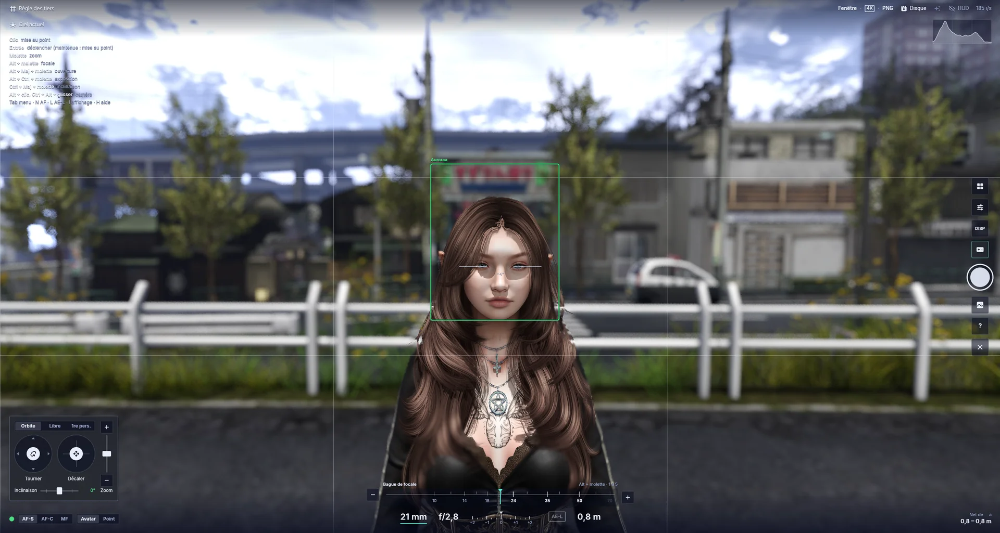

- **Visor de Câmera Completo (Viewfinder)**: sobreposição de câmera profissional em tela cheia com alternância entre níveis de detalhes pelo atalho `I`.
- **Foco Automático Facial**: modos AF-S, AF-C e foco manual. Em avatares, o ponto de foco trava nos olhos e acompanha os movimentos com confirmação sonora.
- **Anéis Virtuais de Lente**: controle de distância focal, abertura do diafragma (abertura) e exposição pela roda do mouse ou arrasto.
- **Profundidade de Campo Real (DoF)** com *focus peaking* manual para ver com precisão matemática o que está nítido.
- **Resoluções até 8K**: presets prontos em PNG, JPEG e BMP, para salvar em disco, enviar para o inventário ou publicar no feed.
- **Isolamento de Objeto / Avatar**: tire fotos do seu avatar ou de amigos com fundo totalmente transparente (canal alfa limpo) para criar cartazes e montagens sem esforço.
- **Filtros e LUTs 3D**: 30 filtros consagrados do visualizador clássico, 36 efeitos modernos embutidos (grão de filme, teal & orange, visual analógico, falha/glitch) e importação direta de arquivos `.cube` do Photoshop, Lightroom ou DaVinci Resolve.

---

### Ferramentas para Criadores

- **LiveMesh para Blender**: veja suas malhas do Blender no visualizador em tempo real enquanto modela, sem precisar enviar nenhum arquivo. Malhas com rigging acompanham o seu avatar; objetos estáticos viram modelos locais manipuláveis ([guia do LiveMesh](docs/BLENDER_LIVE.md)).
- **Poser Integrado**: crie poses para fotos para você, seus animeshes ou amigos que aceitarem o convite, articulação por articulação, com biblioteca de poses, exportação BVH e importação de animação ([guia do Poser](docs/POSER.md)).
- **Bancada de Trabalho IK**: manipulação de cinemática inversa com alvos fixos de contato para criar poses e animações precisas ([guia de IK](docs/IK_EDIT.md)).
- **Edição de Prims sem Complicação**: editor compacto, pré-visualização ao vivo do prim antes de criar, alinhamento magnético contra superfícies (tecla `P`) e busca por área (*Area Search*).
- **Editor de Partículas**: crie e ajuste sistemas de partículas visualmente no prim selecionado com geração automática do código LSL correspondente.

---

### Desempenho

<table>
  <tr>
    <td width="50%" align="center" valign="top">
      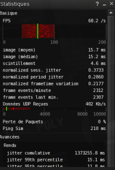<br>
      <b>Legacy Viewer</b> · 68 fps
    </td>
    <td width="50%" align="center" valign="top">
      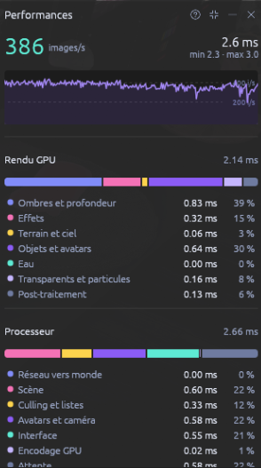<br>
      <b>Aurora upstream / SunSet base</b> · 386 fps
    </td>
  </tr>
</table>

Medição realizada em loja movimentada com cerca de 16.000 objetos no mesmo computador (RTX 4090) e mesmo local.

---

### O que Funciona Hoje

- **Módulo de Combate & Cores Individuais (Exclusivo SunSet)** — combate em tempo real (`scene::combat`), raycasting a partir da mira da tela, hitboxes 3D por avatar/articulação, oclusão por objetos/terreno e cores individuais (`Marcar cor`) compartilhadas entre Hitbox 3D e Minimapa ([guia](docs/HITBOX_E_CORES.md)).
- **Controle de Movimento 100x & Salto Instantâneo / Dash (Exclusivo SunSet)** — velocidade de solo e voo até `100x` via Bridge LSL v1.42, salto instantâneo (`/dash <metros>`) e atalhos em Mouselook (`Tecla E` e `Botão do Meio do Mouse`) ([guia](docs/MOVEMENT_DASH.md)).
- **Distância de Visão até 8.192m (`dd 5000+`) & SpeedRez (Exclusivo SunSet)** — alcance visual estendido de `32m` a `8.192m` via comando de chat `dd`, Preferências Rápidas e Gráficos, harmonizado com a Distância de Visão Progressiva (SpeedRez) ([guia](docs/DRAW_DISTANCE.md)).
- **Upscaling AMD FSR 3.1** — renderização de alta resolução com excelente desempenho utilizando compute shaders WGSL.
- **Localização 100% pt-BR** — tradução nativa em Português do Brasil com mais de 12.770 termos autênticos da comunidade Second Life.
- **Atualizador Automático** — verificação e instalação atômica diretamente dos lançamentos no GitHub.
- **Renderização Vulkan** — pipeline bindless, multi-draw indirect, GTAO, sombras de contato, materiais PBR e legados.
- **Avatares e Bento** — animações suaves, bakes de servidor, roupas em camadas, Quickjump e reset de esqueleto.
- **Modo Foto** — visor de alta precisão, foco automático nos olhos, profundidade de campo, exportação até 8K e suporte a LUTs.
- **Áudio e Voz WebRTC** — voz espacial próxima, cancelamento de ruído, equalização e chamadas de conferência contínuas mesmo durante teletransportes.
- **Inventário em Explorador** — exibição em árvore ou explorador amplo com detalhes, direitos de permissão CMT e filtros rápidos.

---

## Como Usar o SunSet

### Contas e Login
A tela inicial exibe suas contas salvas em cartões com a foto do último local visitado e a grade escolhida. Basta clicar no cartão para entrar. O gerenciador de contas permite organizar a ordem dos cartões, esquecer senhas ou limpar autorizações 2FA.

### Idioma
O SunSet Viewer detecta automaticamente o idioma do seu sistema operacional. Para escolher manualmente:
1. Abra **Preferências › Interface › Idioma**.
2. Selecione **Português do Brasil (`pt-BR`)**, **Inglês (`en`)**, **Francês (`fr`)** ou **Japonês (`ja`)**.
3. A alteração é aplicada instantaneamente, sem necessidade de reiniciar.

### Ajuste de Altura do Avatar (Hover Height)
Abra **Aparência › Altura de flutuação (Hover Height)** para ajustar a altura dos pés em relação ao chão. A opção automática calcula a altura ideal a partir dos calçados anexados.

### Notícias na Tela de Login
O painel lateral de notícias traz os anúncios e notas de lançamento oficiais do SunSet Viewer diretamente da branch `main` do GitHub, mantendo você sempre informado sobre melhorias, novidades e atualizações.

---

## Compilação

**Requisitos:** Windows 10/11 (ou Linux/macOS), [Rust](https://rustup.rs) (versão estável configurada em `rust-toolchain.toml`) e placa de vídeo compatível com Vulkan.

### Compilando no Windows:

```powershell
git clone https://github.com/SunSet-Viewer/SunSet-Viewer
cd SunSet-Viewer
cargo build --release -p aurora-viewer
.\target\release\SunSet-Viewer.exe
```

Para gerar pacotes portáteis oficiais prontos para distribuição com metadados de instalação e versionamento:
```powershell
$env:AURORA_VERSION_TAG = "v0.9.7"
cargo build --release -p aurora-viewer
powershell -ExecutionPolicy Bypass -File "scripts\package.ps1" -Exe "target\release\SunSet-Viewer.exe" -Out "RELEASE\SunSet-Viewer" -Source "."
```

---

## Contribuindo

Ideias, sugestões e relatórios de problemas são muito bem-vindos na nossa página de [Issues no GitHub](https://github.com/SunSet-Viewer/SunSet-Viewer/issues).

Documentação técnica complementar:
- [ATUALIZACAO_V0.9.7.md](docs/ATUALIZACAO_V0.9.7.md) — Guia completo de recursos, integração Aurora v0.9.4 e auditoria da versão v0.9.7.
- [MOVEMENT_DASH.md](docs/MOVEMENT_DASH.md) — Controle de Movimento e Dash Instantâneo (velocidades até 100x e atalhos).
- [DRAW_DISTANCE.md](docs/DRAW_DISTANCE.md) — Distância de Visão estendida (comando `dd 5000` até 8.192m + SpeedRez, estilo Firestorm).
- [HITBOX_E_CORES.md](docs/HITBOX_E_CORES.md) — Caixas de colisão 3D (Hitboxes) e marcação de cores individuais para avatares.
- [CHECKLIST_RELEASE.md](docs/CHECKLIST_RELEASE.md) — Checklist passo a passo para validação e publicação de releases.
- [GUIA_DE_LANCAMENTO_E_NOTICIAS.md](docs/GUIA_DE_LANCAMENTO_E_NOTICIAS.md) — Regras de publicação de releases e notícias da tela de login.
- [BRANDING.md](docs/BRANDING.md) — Paleta de cores, ícones e regras de interface.
- [BLENDER_LIVE.md](docs/BLENDER_LIVE.md) — Integração em tempo real com o Blender.
- [POSER.md](docs/POSER.md) — Guia do editor de poses para fotos.
- [RLVA.md](docs/RLVA.md) — Especificação e comandos RLVa.
- [TESTING.md](docs/TESTING.md) — Variáveis e cenários de testes offline.

---

## Licença e Atribuição Legal

O SunSet Viewer é um software livre distribuído sob a licença **[GNU General Public License v3.0 (GPL-3.0)](LICENSE)**.

- O SunSet Viewer é uma modificação mantida de forma independente, derivada do projeto de código aberto **Aurora Viewer**.
- Partes do código são originárias ou portadas do cliente oficial do **Second Life** e do **Firestorm** (originalmente sob LGPL 2.1). Todos os autores e licenças de componentes de terceiros estão devidamente creditados em [NOTICE.md](NOTICE.md).
- Este projeto não possui afiliação oficial com a Linden Lab, com a equipe do Firestorm nem com os mantenedores do Aurora Viewer.
- Second Life® é uma marca registrada da Linden Research, Inc.
