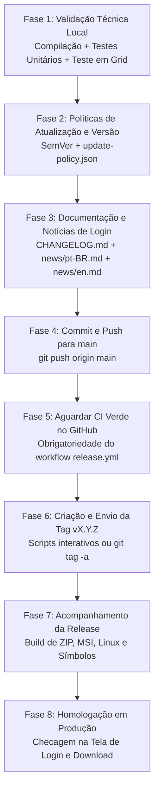

# Checklist Definitivo de Lançamento de Release — SunSet Viewer

> [!IMPORTANT]
> **Documento Oficial de Engenharia e Operações**  
> Siga este checklist passo a passo rigorosamente para preparar, homologar, etiquetar e publicar novas versões (Releases) do **SunSet Viewer**. Não pule nenhuma etapa para evitar quebras de CI, erros de atualização em cascata ou links quebrados.

---

## Fluxo Geral de Lançamento



---

## Fase 1: Validação Técnica e Sanidade Local

Antes de fazer qualquer commit ou push para o repositório remoto, valide se o código está 100% estável e funcional na máquina local.

- [ ] **1.1. Verificação global do workspace (`cargo check`):**
  ```powershell
  cd SunSet-Viewer
  cargo check --workspace
  ```
  *Critério:* Saída com código 0, sem erros de tipagem, módulos faltantes ou conflitos de merge.

- [ ] **1.2. Bateria de testes unitários do SunSet Viewer:**
  Execute todas as suítes essenciais:
  ```powershell
  # Movimento, Saltos, Dash 100x e Natação
  cargo test -p aurora-viewer --bin SunSet-Viewer movement::tests

  # Comandos de chat, calculadora e linha de comando
  cargo test -p aurora-viewer --bin SunSet-Viewer cmdline

  # Distância de visão progressiva e suporte a dd 5000+
  cargo test -p aurora-viewer --bin SunSet-Viewer settings::draw_stepping

  # Hitbox 3D e detecção de oclusão por Raycast
  cargo test -p aurora-viewer --bin SunSet-Viewer combat

  # Rede e Bridge LSL
  cargo test -p aurora-net --lib bridge
  ```
  *Critério:* Todos os testes devem passar (100% OK, 0 failed).

- [ ] **1.3. Validação rigorosa de internacionalização (i18n):**
  ```powershell
  cargo test -p aurora-i18n
  ```
  *Critério:* O teste `every_language_has_english_keys_and_variables` deve passar com sucesso. O catálogo `pt-BR.ftl` deve ter paridade exata de chaves e variáveis com `en.ftl`.

- [ ] **1.4. Compilação Release Local:**
  ```powershell
  cargo build --release -p aurora-viewer
  ```
  *Critério:* O binário `target\release\SunSet-Viewer.exe` deve ser gerado sem erros.

- [ ] **1.5. Homologação In-World (Teste no Second Life):**
  Abra o `target\release\SunSet-Viewer.exe` compilado e conecte-se a uma sandbox:
  - Teste o floater `/dash` (verifique se 10x, 20x, 50x, 100x aceleram o avatar).
  - Teste o comando `dd 5000` (verifique se a distância de visão atinge 5.000m sem corte para 512m/1024m).
  - Teste a exibição de Hitbox 3D (`Ctrl+Alt+Shift+H`) e marcação de cores individuais de avatares.
  - Verifique se a interface está em Português sem textos em inglês soltos.

---

## Fase 2: Definição de Versão e Políticas de Atualização

- [ ] **2.1. Escolha do número SemVer (`vMAJOR.MINOR.PATCH`):**
  - **PATCH (`v0.9.5`):** Apenas correções de bugs, ajustes de tradução ou melhorias internas de estabilidade.
  - **MINOR (`v0.10.0`):** Novas funcionalidades para o usuário (ex: novos floaters, novos atalhos, integração de upstream major).
  - **MAJOR (`v1.0.0`):** Mudança arquitetural de grande impacto.
  - *Sufixo Pre-Release:* Use `-beta.1` ou `-rc.1` caso seja uma versão experimental para testes restritos.

- [ ] **2.2. Avaliação da Política de Atualização (`update-policy`):**
  Decida os parâmetros para usuários de versões antigas:
  - `minimum_supported_version`: Exige que versões abaixo deste número atualizem obrigatoriamente.
  - `grace_hours`: Tempo de tolerância em horas antes do bloqueio (padrão: `12`). Use `0` para bloqueio imediato se houver falha de segurança crítica.
  - `cache_invalidation_before`: Se o formato do cache de texturas/mesh mudou, informe a versão para limpar o cache automaticamente.
  - `settings_reset_before`: Se as configurações salvas em disco forem incompatíveis, informe para resetar e migrar com segurança.

---

## Fase 3: Documentação e Notícias da Tela de Login

> [!CAUTION]
> As notícias da tela de login são lidas diretamente da branch `main` do GitHub. Um link incorreto ou texto mal formatado afetará todos os usuários instantaneamente.

- [ ] **3.1. Atualizar o `CHANGELOG.md`:**
  - Crie uma seção com a nova versão `## [vX.Y.Z] - AAAA-MM-DD`.
  - Liste as novidades agrupadas em: *Novas Funcionalidades*, *Correções de Bugs*, *Desempenho*, *Localização*.

- [ ] **3.2. Redigir os cards de notícias (`news/pt-BR.md`, `news/pt.md` e `news/en.md`):**
  Adicione a nova notícia no topo dos três arquivos, respeitando os limites:
  - **Título:** Máximo de 120 caracteres (`## AAAA-MM-DD — SunSet Viewer vX.Y.Z: Título Atraente`).
  - **Corpo:** Máximo de 600 caracteres, texto corrido sem listas de marcadores (* ou -).
  - **Link:** Exclusivamente no formato abaixo e sozinho na linha:
    ```markdown
    [Saiba mais](https://github.com/SunSet-Viewer/SunSet-Viewer/releases/tag/vX.Y.Z)
    ```
  - *Arquivos obrigatórios:*
    - `news/pt-BR.md` (Prioritário em Português)
    - `news/pt.md` (Fallback idêntico)
    - `news/en.md` (Versão em Inglês)

- [ ] **3.3. Atualizar tarefas em `TASKS.md`:**
  - Marque como concluídas as tarefas finalizadas nesta versão.

---

## Fase 4: Commit e Envio para a Branch `main`

- [ ] **4.1. Revisão do status do repositório local:**
  ```powershell
  git status
  ```
  *Critério:* Nenhum arquivo temporário, log ou script descartável deve ser adicionado.

- [ ] **4.2. Commit das alterações de release:**
  ```powershell
  git add CHANGELOG.md news/pt-BR.md news/pt.md news/en.md TASKS.md docs/
  git commit -m "chore(release): prepare vX.Y.Z (changelog, news, docs)"
  ```

- [ ] **4.3. Envio da branch `main` para o remoto:**
  ```powershell
  git push origin main
  ```

---

## Fase 5: O Passo Crítico — Aguardar CI Verde no GitHub

> [!WARNING]
> **REGRA DE OURO DO WORKFLOW RELEASE:**  
> O workflow de release do GitHub (`.github/workflows/release.yml`, linha 49) verifica se o commit na `main` possui um workflow de **CI concluído com sucesso** (`status == completed` e `conclusion == success`).  
> **NUNCA crie nem envie a tag antes do CI da `main` terminar!** Se a tag for enviada antes, a publicação da Release falhará com o erro:  
> `The tagged commit must have a successful CI run before release.`

- [ ] **5.1. Acompanhar a execução do CI:**
  ```powershell
  gh run list --workflow CI --branch main --limit 1
  ```
  Ou acompanhe pela interface web do GitHub na aba **Actions** > workflow **CI**.

- [ ] **5.2. Confirmar conclusão com sucesso:**
  Aguarde até que o status seja `completed` e a conclusão seja `success` (ícone verde).

---

## Fase 6: Criação e Envio da Tag de Release

Após o CI na `main` ficar 100% verde:

### Opção A: Via Ferramenta Automatizada (Recomendado)
Execute a ferramenta oficial do repositório:
```powershell
.\scripts\tools\releases.ps1
```
1. O script verificará automaticamente se o CI está verde.
2. Sugerirá o número de versão SemVer adequado.
3. Permitirá configurar a política de atualização (grace period, versão mínima).
4. Criará a tag anotada e enviará para o GitHub com todos os metadados necessários.

### Opção B: Manualmente via Git CLI
Caso prefira via linha de comando manual:
```powershell
# 1. Defina o número da versão
$TAG = "vX.Y.Z"

# 2. Defina a mensagem e a política em JSON embutido
$MSG = @"
SunSet Viewer $($TAG.TrimStart('v'))

Aurora-Update-Policy: {"minimum_supported_version":null,"grace_hours":12,"cache_invalidation_before":null,"settings_reset_before":null}
"@

# 3. Crie a tag anotada apontando para o commit atual da main
git tag -a $TAG origin/main -m $MSG

# 4. Envie a tag para o GitHub
git push origin $TAG
```

---

## Fase 7: Acompanhamento da Pipeline de Publicação da Release

Assim que a tag for enviada, o GitHub Actions aciona automaticamente o workflow `.github/workflows/release.yml`.

- [ ] **7.1. Monitorar o workflow de release:**
  ```powershell
  gh run watch --workflow Release
  ```
  Ou visualize em `https://github.com/SunSet-Viewer/SunSet-Viewer/actions/workflows/release.yml`.

- [ ] **7.2. Conferir artefatos gerados pelo workflow:**
  O pipeline compila e anexa automaticamente na Release do GitHub:
  - `SunSet-Viewer-windows-x64-vX.Y.Z.zip` (Pacote portátil Windows)
  - `SunSet-Viewer-windows-x64-vX.Y.Z.msi` (Instalador oficial Windows)
  - `SunSet-Viewer-linux-x64-vX.Y.Z.tar.gz` (Pacote Linux)
  - `SunSet-Viewer-windows-x64-vX.Y.Z-symbols.zip` (Símbolos PDB para crash dump triage)
  - `update-policy.json` (Políticas de versão para o sistema de auto-update)

---

## Fase 8: Homologação Pós-Publicação em Produção

Após a conclusão bem-sucedida da Release no GitHub:

- [ ] **8.1. Validar a página de Releases no GitHub:**
  - Acesse: `https://github.com/SunSet-Viewer/SunSet-Viewer/releases/tag/vX.Y.Z`
  - Certifique-se de que a release **não está em Draft** e está marcada como **Latest Release** (se for estável).
  - Verifique se os arquivos `.zip` e `.msi` estão disponíveis para download.

- [ ] **8.2. Validar a Tela de Login do SunSet Viewer:**
  - Abra o SunSet Viewer.
  - Verifique se o card de notícias na lateral direita exibe o título da nova versão.
  - Clique em **"Saiba mais"** e certifique-se de que abre o link correto da release.

- [ ] **8.3. Validar a Checagem de Atualizações Automáticas:**
  - Abra uma instalação de versão anterior do SunSet Viewer.
  - Vá em *Preferências* > *Idioma e atualizações* > clique em *Verificar agora*.
  - Confirme que a notificação oferece a nova versão `vX.Y.Z` para download.

- [ ] **8.4. Anúncio para a Comunidade:**
  - Compartilhe as novidades no Discord oficial, grupos in-world do Second Life e redes sociais.

---

## Tabela de Resumo Rápido

| Etapa | Ação Principal | Comando / Ferramenta | Ponto de Atenção |
| :--- | :--- | :--- | :--- |
| **1. Validação Técnica** | Rodar todos os testes unitários | `cargo test -p aurora-viewer ...` | 0 falhas permitidas |
| **2. Teste em Grid** | Homologar o `.exe` localmente | `target\release\SunSet-Viewer.exe` | Testar dash, dd 5000 e hitbox |
| **3. Notícias de Login** | Atualizar `news/pt-BR.md` e `en.md` | Editor de texto | Link exato para o repo SunSet |
| **4. Envio para main** | Commit e push da branch principal | `git push origin main` | Revisar `git status` |
| **5. Aguardar CI** | Esperar workflow `CI` ficar verde | `gh run list --workflow CI` | **NUNCA gerar tag antes disso** |
| **6. Envio da Tag** | Criar e subir a tag SemVer | `.\scripts\tools\releases.ps1` | Tag deve começar com `v` |
| **7. Build de Release** | Acompanhar workflow no GitHub | `gh run watch --workflow Release` | Gera MSI, ZIP e Símbolos |
| **8. Pós-Lançamento** | Testar tela de login e updater | Iniciar o SunSet Viewer | Confirmar cards e download |
