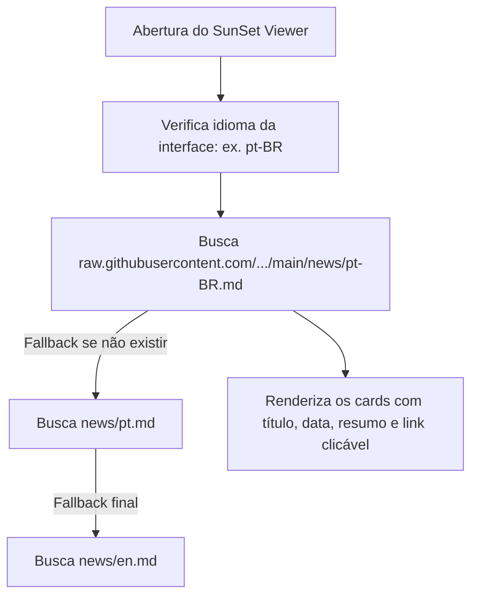

# Guia Obrigatório de Lançamento de Releases e Notícias na Tela de Login

> [!IMPORTANT]
> **Leitura Obrigatória para Lançamento de Versões do SunSet Viewer**  
> Sempre que uma nova versão (Release) for lançada ou anunciada, é **obrigatório** seguir o [Checklist Definitivo de Release](CHECKLIST_RELEASE.md) e criar uma publicação profissional e atraente no quadro de notícias da tela de login, garantindo que o link de redirecionamento aponte exclusivamente para o repositório oficial do **SunSet Viewer** (`https://github.com/SunSet-Viewer/SunSet-Viewer/releases/...`).

---

## 1. Como Funciona o Painel de Notícias da Tela de Login

O SunSet Viewer possui um painel integrado de notícias no canto direito da tela de login. Ele se comunica em tempo real com o repositório GitHub da seguinte forma:



- **Sem necessidade de recompilar:** As notícias são lidas diretamente da branch `main` do GitHub via `https://raw.githubusercontent.com/SunSet-Viewer/SunSet-Viewer/main/news/`.
- **Efeito imediato:** Assim que o arquivo for atualizado e enviado para o GitHub (`git push origin main`), em poucos minutos todos os usuários que abrirem o visualizador verão o anúncio na tela de login, mesmo antes de atualizarem o executável.
- **Cache local:** Se o usuário estiver sem internet no momento da abertura, o SunSet Viewer exibe as últimas notícias salvas em cache local ou os arquivos compilados embutidos.

---

## 2. Regras Técnicas Estritas de Formatação

O analisador Markdown do SunSet Viewer (`crates/aurora-viewer/src/ui/news/markdown.rs`) segue limites técnicos específicos:

| Elemento | Limite / Regra | O que acontece se exceder |
| :--- | :--- | :--- |
| **Título da Notícia** | Máximo de **120 caracteres** | Texto é cortado com reticências `…` |
| **Resumo / Texto** | Máximo de **600 caracteres** | Texto é cortado com reticências `…` |
| **Quantidade de Notícias** | Máximo de **20 notícias** por arquivo | Notícias mais antigas são ignoradas |
| **Link de Destino** | Máximo de **512 bytes**, somente `https://` | Se inválido, o card fica sem link |
| **Formato da Data** | Padrão ISO `AAAA-MM-DD` | Se ausente, a data fica vazia |

### Sintaxe Exata da Notícia

```markdown
## AAAA-MM-DD — Nome do Visualizador vX.Y.Z: Título Chamativo e Profissional
Parágrafo descritivo destacando os principais benefícios, correções de bugs,
novas funcionalidades e melhorias de desempenho. Texto limpo e direto,
sem listas com marcadores (* ou -), sem negrito excessivo e sem imagens.

[Saiba mais](https://github.com/SunSet-Viewer/SunSet-Viewer/releases/tag/vX.Y.Z)
```

> [!WARNING]
> - O separador após a data deve ser um travessão `—`, hífen `-` ou dois-pontos `:`.
> - O link **deve ficar sozinho na linha** e começar obrigatoriamente com `https://github.com/SunSet-Viewer/SunSet-Viewer/releases/tag/...`.
> - Nunca utilize links do repositório legado do Aurora Viewer (`Aurora-Viewer/Aurora-Viewer/releases/...`).

---

## 3. Padrão de Redação Profissional e Elegante

Para transmitir confiança, clareza e credibilidade à comunidade de usuários e criadores de conteúdo do Second Life, siga esta estrutura:

1. **Título:** Destaque o nome do visualizador, versão e o principal atrativo (ex: *SunSet Viewer v0.9.4: Correções completas de localização em Português*).
2. **Contexto e Valor:** Explique logo no início o que melhora na experiência do usuário (ex: termos mais naturais, mais FPS, menos travamentos).
3. **Mudanças-chave:** Cite de forma fluida 3 a 4 itens de maior impacto prático (ex: inventário com "Em uso", corrida com "Sempre correr", opção "Desanexar de você").
4. **Chamada para Ação (CTA):** Linha isolada com link direto para as Release Notes completas no GitHub.

---

## 4. Onde Editar os Arquivos de Notícias

Os arquivos estão localizados na raiz da pasta `news/`:

- `news/pt-BR.md`: **Prioritário** para usuários que utilizam o visualizador em Português do Brasil (`pt-BR`).
- `news/pt.md`: Fallback para usuários em Português genérico (`pt`). Deve ser idêntico ou equivalente ao `pt-BR.md`.
- `news/en.md`: Versão em Inglês exibida para o restante do mundo ou caso o idioma do sistema não possua arquivo dedicado.

---

## 5. Checklist Passo a Passo Obrigatório para Release

Ao preparar e lançar uma nova versão do SunSet Viewer:

### Etapa 1: Atualizar o Histórico de Versões
1. Atualize `CHANGELOG.md` com a lista detalhada de commits, melhorias e agradecimentos.

### Etapa 2: Redigir a Notícia da Tela de Login
1. Abra `news/pt-BR.md` e adicione a nova notícia no topo (abaixo do comentário HTML).
2. Replique a notícia em `news/pt.md`.
3. Escreva a versão em inglês no topo de `news/en.md`.
4. Garanta que o link seja: `https://github.com/SunSet-Viewer/SunSet-Viewer/releases/tag/vX.Y.Z`.

### Etapa 3: Criar a Tag e Enviar para o GitHub
```powershell
git -C SunSet-Viewer add CHANGELOG.md news/pt-BR.md news/pt.md news/en.md
git -C SunSet-Viewer commit -m "docs: release notes and login news for vX.Y.Z"
git -C SunSet-Viewer tag vX.Y.Z
git -C SunSet-Viewer push origin main
git -C SunSet-Viewer push origin vX.Y.Z
```

### Etapa 4: Compilar o Executável Oficial
Defina a variável de ambiente `AURORA_VERSION_TAG` com a tag exata para que o visualizador não seja considerado "Versão de desenvolvimento", permitindo que o verificador de atualizações automáticas funcione:
```powershell
$env:AURORA_VERSION_TAG = "vX.Y.Z"
cargo build --manifest-path SunSet-Viewer/Cargo.toml --release -p aurora-viewer
```

### Etapa 5: Empacotar e Gerar Checksum SHA-256
```powershell
powershell -ExecutionPolicy Bypass -File "SunSet-Viewer\scripts\package.ps1" `
  -Exe "SunSet-Viewer\target\release\SunSet-Viewer.exe" `
  -Out "RELEASE\SunSet-Viewer" `
  -Source "SunSet-Viewer"

Compress-Archive -Path "RELEASE\SunSet-Viewer\*" `
  -DestinationPath "RELEASE\SunSet-Viewer-vX.Y.Z-windows-x64.zip" -Force

$hash = (Get-FileHash -Algorithm SHA256 "RELEASE\SunSet-Viewer-vX.Y.Z-windows-x64.zip").Hash.ToLower()
"$hash  SunSet-Viewer-vX.Y.Z-windows-x64.zip" | Out-File -Encoding ascii "RELEASE\SunSet-Viewer-vX.Y.Z-windows-x64.zip.sha256"
```

### Etapa 6: Publicar no GitHub Releases
Faça o upload do `.zip` e do arquivo de checksum `.sha256`:
```powershell
gh release create vX.Y.Z `
  "RELEASE\SunSet-Viewer-vX.Y.Z-windows-x64.zip" `
  "RELEASE\SunSet-Viewer-vX.Y.Z-windows-x64.zip.sha256" `
  --title "SunSet Viewer vX.Y.Z" `
  --notes-file "RELEASE_NOTES_vX.Y.Z.md" `
  -R SunSet-Viewer/SunSet-Viewer
```

---

## 6. Modelo / Template Pronto para Copiar

### Modelo Português (`news/pt-BR.md` e `news/pt.md`)
```markdown
## AAAA-MM-DD — SunSet Viewer vX.Y.Z: Destaque Principal da Versão
A versão vX.Y.Z traz melhorias significativas de desempenho e estabilidade para sua exploração no Second Life. Esta atualização inclui aprimoramentos no sistema de renderização gráfica, ajustes no módulo de combate com detecção de precisão, correções no inventário e refinamentos nas traduções em Português do Brasil para tornar a navegação ainda mais intuitiva.

[Saiba mais](https://github.com/SunSet-Viewer/SunSet-Viewer/releases/tag/vX.Y.Z)
```

### Modelo Inglês (`news/en.md`)
```markdown
## AAAA-MM-DD — SunSet Viewer vX.Y.Z: Core Highlight of the Release
Version vX.Y.Z introduces major stability and rendering performance updates for Second Life. Highlights include enhanced graphic scaling, refined combat hitboxes and raycasting precision, inventory attachment optimizations, and comprehensive localization updates.

[Read more](https://github.com/SunSet-Viewer/SunSet-Viewer/releases/tag/vX.Y.Z)
```

